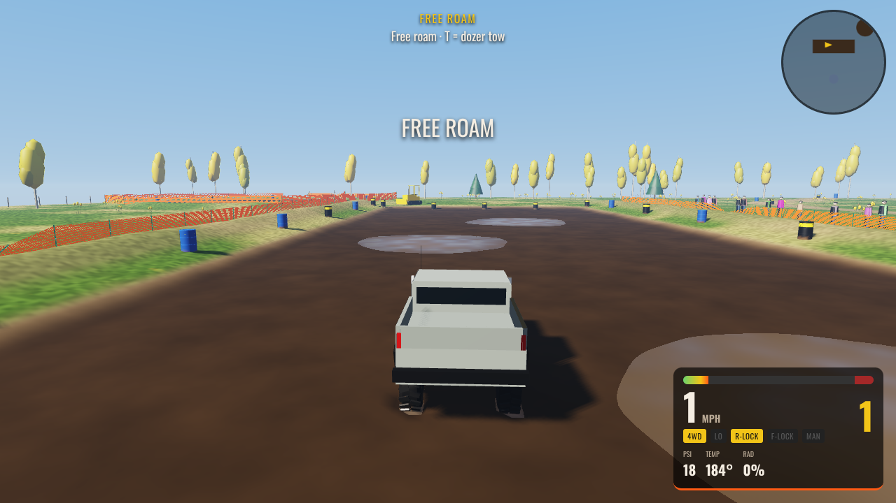
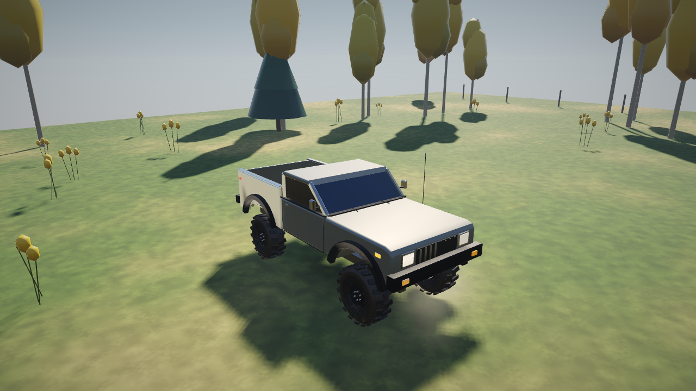
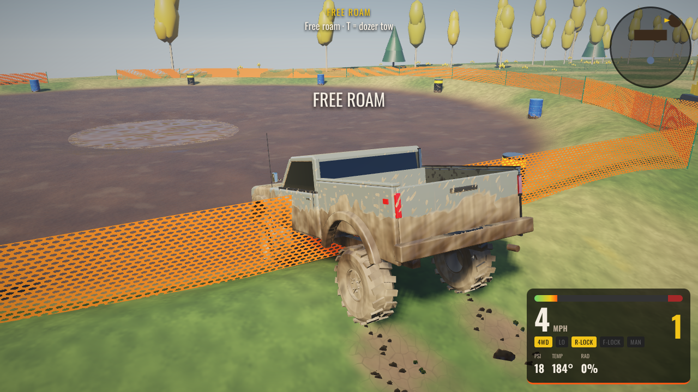

# Mud Buddies

An online multiplayer **mud bogging sim-cade** — C++20 compiled to WebAssembly, WebGL2
rendering, fully procedural audio, gamepad-first controls, competitive modes, leaderboards and a
parametric CAD pipeline for every asset. The venue, vehicles and failure modes are modeled on the
reference photos (see [docs/FORENSICS.md](docs/FORENSICS.md)).

> Bog it. Sling it. Get stuck with your buddies.

| The pit | Garage | Caked after a run |
|---|---|---|
|  |  |  |

<sub>Captured headless with the software rasterizer; real GPUs render the same scene at full frame rate.</sub>

## Play
```bash
node server/server.js          # serves web/ + multiplayer + leaderboards on :8787
open http://localhost:8787
```
**Single file:** [`dist/mudbuddies.html`](dist/mudbuddies.html) is the whole game in one ~1 MB HTML
(WASM, JS, CSS and CAD parts inlined) — double-click it to play solo offline, or host it anywhere.
Rebuild it with `python3 tools/make_standalone.py` after `./build.sh`.

The prebuilt WASM is committed in `web/build/`, so no toolchain is needed to play. Any static
host works for single-player (`web/` folder); multiplayer and global leaderboards need the Node
server (zero npm dependencies, Node ≥ 18).

## What's in it
| | |
|---|---|
| **Terramechanics** | Bekker pressure–sinkage per terrain cell with viscous sinkage rate (momentum matters), Janosi–Hanamoto shear traction, Rankine bulldozing, suction, slurry/water drag. Tires dig holes, roost re-deposits where it lands, ruts fill with water, soupy mud flows back. [docs/PHYSICS.md](docs/PHYSICS.md) |
| **Map** | 384 m × 384 m deformable world: the mud-bog venue (drag pit, freestyle bowl, two-track circuit, pond, old bus) in the middle, ringed by back-country — a wooded trail loop with mud holes, a 16 m hill with a mud climb chute, a creek with fords, western mud flats, a peat swamp, patchy forest. North-up minimap built from the terrain and building footprints. |
| **Venue grounds** | Laid out like a real mud park, with the competitor loop *paddock → staging → course → shutdown → return road → wash bay → paddock* and a separate spectator side. Gate arch and a ticket booth (TICKETS sign, belt-stanchion queue lane, pennant string, sandwich board) on a gravel entrance road; a skirted race-office trailer with a wheelchair ramp, door awning, rooftop A/C and meter post; visitor parking; a village with a food-truck row, pavilion, concession, merch canopies, stage and lawn, porta-johns and handwash stations; metal buildings (pro shop, restrooms, concessions, bathhouse) with name signs on the gable, standing-seam roofs, cupolas, gutters and downspouts, wainscot, door awnings and benches, gooseneck lights, bollards, condensers and drink machines; event canopies furnished with a folding table, camp chairs, a cooler and leg sandbags; first aid. A start gantry over the four lanes (lattice towers, box truss, a drag-strip start tree and lane number per lane, START banner) and a red padded finish arch with a checkered band, FINISH lettering and timing eyes. Pit-side covered grandstands (shade roof with GRANDSTAND fascia, X-braced understructure, centre aisle stairs with yellow nosings and handrails, row numbers, a front rail with MUD BUDDIES banners); an announcer tower with a hollow booth where the announcer and race director stand at a desk of monitors, mics and a mixer behind see-through glass, a LIVE sign and flags; LED results boards; burnout-pad walls of real lugged tyres; sponsor banners; light towers. Paddock rows of dually haulers with flatbed/enclosed trailers, canopies, pit clutter and crews; registration and tech inspection; cone staging lanes with officials; a recovery loader; show-and-shine lawn; campground with RVs, campers, tents, fire rings, hookups and a bathhouse. Different wear everywhere: gravel roads, mud tracked onto the return road, trampled paths. A working **wash bay** (stop on the pad: dirt, wheel cake and radiator mud come off). |
| **Career economy** | Start with $2,500 and the stock Comanche. Events pay prize money (full passes and fast times pay more, the Bounty Hole pays its whole pot, a winner bonus when racing rivals); trucks, engines, bigger tires, lift, regears, diffs, beadlocks, winch, snorkel and paddles cost money, and the pit crew bills you for bent rods, U-joints, belts and beads. Can be switched off in Settings for a sandbox with everything unlocked. |
| **Open Pits challenges** | Paid goals out in the back-country during free roam: King of the Hill ($300), Peat Swamp Crossing ($400), Ford the Creek ($150), Sand Flats Speed Run ($200), Trail Loop ($500). Listed with hints on the pause screen; finished goals are saved in the browser and stay done (and paid once) across reloads. |
| **Weather & time of day** | Dry, overcast or rain: clouds thicken, the sun dims and cools, rain streaks fall around you with drops on the lens, fog closing in, the hiss and patter of rain, and lightning with thunder that arrives after the sound's travel time — and the rain soaks the whole park over a few minutes (every field gets softer and slicker; gravel roads drain), drying out slowly after it stops; the bog pit, pond and bounty trench fill up by ~18 cm. Afternoon, midday, a low warm golden hour, or **night**: moonlight and stars, the venue's light towers flood the pit, paddock and village, and every truck runs its headlights (light count scales with the graphics setting). In multiplayer the host's weather, time of day and how soaked the park is go to the whole room when the event starts, so everyone races the same conditions (lightning and thunder follow a shared seed, so strikes land together); solo play goes back to your own settings. |
| **PA announcer** | Lane introductions with each truck's racing name, body and class; calls full passes and dozer tows as they happen. |
| **Suspension** | Quarter-car per corner (unsprung wheel mass, pressure-dependent tire spring, bump/rebound damping, hydraulic bump stops, anti-roll bars), load-sensitive tires; `mb_tests --probe` prints a handling report. |
| **Soils** | Five soil types with their own Bekker/shear parameters and colour: sticky **clay gumbo** (packs treads, remolds to grease when churned), weak **silt**, strong-but-draggy **wet sand**, bottomless **peat muck**, honest **loam**. Placed by area (clay pit and chute, silty pond and creek, sand flats, peat swamp). |
| **Getting stuck** | High-centering on diff pumpkins and frame rails, tread packing with clay (wheel speed flings it out), open diffs vs lockers, radiator clogging → overheating. Ways out: rock it, air down, lockers, 4L, then the recovery kit. |
| **Drivetrain** | Part-time transfer case **2H / 4H / 4L** (4H windup on grippy ground snaps the front U-joint), per-axle **open / limited-slip / selectable locker / spool**, brake traction control, beadlocks. Lockers engage only when slow and not spinning. |
| **Hazards** | Real **hydrolock** (dead until it drains; crank it underwater and you bend a rod), UTV **CVT belt** heat in high range, **wet brakes** after crossings, mud **caked in the wheels** shakes the truck, **bead pops** below 8 psi without beadlocks. |
| **Recovery kit** | Recovery menu (T / View): **scout** the section ahead (water, soft depth, soil, firm bottom, your ground pressure), **shovel** out ramps and the belly, wedge **traction boards** under the drive tires, **winch** to a tree / rig / post (drum layers, duty cycle, shock-load line snap), then the **dozer** as last resort. |
| **Coaching** | A field-guide coach line on the HUD: digging, bellied out, packed tread, traction back, driveline binding, belt heat, flooded, wet brakes, bead off. In-game **Field Guide** screen. |
| **Garage spec sheet** | Crawl ratio, diff clearance, ground pressure, lb/hp, effective gearing on bigger tires with the re-gear target, and the competition class (Stock / Modified / Pro). Pressure-wash & repair. |
| **Vehicles** | '88 Comanche MJ, '79 square-body pickup, '78 full-size 2-door 4x4, '76 full-size bog car, crew-cab diesel mud truck, sport UTV, mud ATV (CVT, rider), and a mega truck on 54" tires; 6 engines; tire size 29–66", width up to 24", A/T / M/T / paddles, lift, axle gears, diffs, 4WD, snorkel, beadlocks, winch, on-board air, paint. Running gear is drawn live from the suspension: solid axles with diff housings, driveshafts with U-joints, 4-links, track bar, coilovers whose springs compress, tie rod and drag link that follow the steering, red brake calipers; the UTV and ATV get double A-arms and CV shafts. Every truck carries red recovery D-rings and a hitch receiver with a shackle block; buying the winch adds a bumper winch (drum, motor, control box, roller fairlead, orange synthetic line and hook) and buying the snorkel adds a raised-air snorkel up the passenger A-pillar, on whichever truck you drive. The default Comanche is built out with a roof light bar, ditch lights, rock sliders, a bed roll bar with lights, a strapped spare and jerry can, traction boards on the bed side, mud flaps, side-exit exhaust and door lettering. The crew-cab diesel runs twin chrome stacks, a bed rack loaded with a spare, jerry cans and traction boards, amber cab lights and race number 22; the square-body is a farm-truck bogger with wooden stake sides, a hay bale and feed bucket, an A-pillar spotlight and a CB whip; the full-size 4x4 is a trail rig with a roof basket (jerry cans, hi-lift jack, shovel, recovery bag) and ditch lights. Truck glass is see-through onto a full cab interior (dash and gauges, wheel, bucket seats, shifters, roll bar) with a helmeted driver at the wheel; the UTV has its driver in the open cockpit. AI rivals run named rigs ("Gumbo Gobbler", "The Undertaker"…). Paddock and campground also have tow rigs, trailers, motorhomes, campers, loader tractors and visitor cars. |
| **Audio** | Per-cylinder firing-order pulses into exhaust waveguides (real cross-plane V8 burble, limiter bounce, pops), diesel clatter, turbo/blower, lug-slap granular mud, Minnaert water bubbles, debris patter, barrel modal synthesis, crowd, dozer idle, tree-line slapback, Doppler. [docs/AUDIO.md](docs/AUDIO.md) |
| **Modes** | **Mud Bog** (4-lane drag pit with whoops, sinkholes and a deep soup section; no clock — full pass = time, else distance when you call the dozer), **Hill & Hole** (3-lap circuit), **Mud Slinger** (90 s freestyle combo scoring), **King of the Pit** (120 s zone control), **Bounty Hole** (one shot at a bottomless clay trench; clear it to take the pot, every failure grows it), **Burnout Contest** (30 s on the concrete pad: GAS+BRAKE line-locks the fronts, smoke the rears, roll off the pad and you're out), **Open Pits** (free roam). Tires smoke whenever they spin on hard, dry ground. |
| **Leaderboards** | Fastest pass, farthest distance, best lap, race time, freestyle score, crown time — server-validated, with local fallback. |
| **Multiplayer** | Rooms / quick match (8 players), lane assignment, clock-synced countdowns, 20 Hz snapshots with Hermite interpolation, chat. [docs/NETCODE.md](docs/NETCODE.md) |
| **CAD repo** | `cad/` — parametric `.mbcad` part files are the single source of truth; the game builds meshes from them at runtime; `mbcad` exports OBJ + OpenSCAD. [cad/README.md](cad/README.md) |
| **AI rivals** | Solo events field up to 3 rivals with distinct builds (bog car, diesel crew cab on paddles, UTV, built Comanches) running the same terramechanics: pure-pursuit steering, brake-distance speed planning, and a human stuck strategy — air down, rock it, give up or call the dozer. |
| **Contact** | Truck-vs-truck collisions (2D OBB separating-axis test + restitution/friction impulses), knockable barrels, leaning fence posts, venue boundary. |
| **Ghost** | Your personal-best Mud Bog / Hill & Hole run is recorded at 20 Hz and replayed as a translucent ghost. |
| **Post FX** | 4x MSAA offscreen target; half-res screen-space ambient occlusion from the resolved depth buffer (High quality; grounds trucks, crowds, bleachers and truck beds, depth-aware upsample) and sun shafts streaming through the treeline when you face a low sun (Medium/High, strongest at golden hour); a ragged treeline band in the reflection environment so paint, glass and water show a horizon line; quarter-res bloom (bright pass + separable gaussian, stronger at night), light unsharp mask, mud splats and refracting water drops on the camera lens from nearby roost, vignette, warm grade with a gentle S-curve. Dust trails on dry dirt and gravel, tire smoke on hard ground. |
| **Dev panel** | Dear ImGui overlay (**F1** or **`**): live terramechanics/vehicle multipliers, per-wheel telemetry table + plots, wet/dry the pit, sun position, audio mix. |
| **Input** | W3C Gamepad API (Xbox/PlayStation standard mapping) with rumble, full menu navigation by pad; keyboard + mouse. |

## Controls
| Action | Gamepad | Keyboard |
|---|---|---|
| Throttle / brake-reverse | RT / LT | W / S |
| Steer · look | Left stick · right stick | A / D · mouse drag |
| Handbrake | A | Space |
| Lockers (selectable only) | B | L |
| Shift down / up (manual) · auto/manual | X / Y · D-pad ← | Q / E · M |
| Transfer case 2H → 4H → 4L | LB | G |
| Air up / down | D-pad ↑ / ↓ | F / V |
| Camera | RB | C |
| Recovery menu · reset · horn · pause | View · L3 · R3 · Menu | T · R · H · Esc |
| Scout · shovel · traction boards · winch | — · — · — · D-pad → | Z · K · B · J |
| Developer panel | — | F1 or ` |

## Build from source
```bash
# Native: tests + tools (mbcad, render_wav, audio_probe)
cmake -B build-native -DCMAKE_BUILD_TYPE=Release && cmake --build build-native -j
./build-native/mb_tests && node tests/server_test.mjs

# WebAssembly (requires emsdk; fetches Dear ImGui via CMake FetchContent)
./build.sh            # = emcmake cmake -B build-wasm && cmake --build build-wasm  → web/build/
                      # add -DMB_DEVTOOLS=OFF to leave the dev panel out (~400 KB smaller)
```

## Layout
```
src/core      math, noise            src/terrain  deformable multi-layer heightfield
src/physics   terramechanics, vehicle, catalog
src/cad       mbcad kernel           src/audio    DSP primitives + game audio engine
src/net       snapshots, interpolation
src/game      world builder, modes, particles, orchestration
src/render    WebGL2 renderer        src/input    gamepad / keyboard / mouse
src/main.cpp  WASM C API             web/         HTML/CSS/JS shell
server/       Node WebSocket + leaderboards      cad/  parametric asset repo
tools/        mbcad, render_wav, audio_probe     tests/  native + server tests
docs/         FORENSICS, PHYSICS, AUDIO, NETCODE, TECH_STACK
```

## Notes
* Only still photos were provided as references; the sound design is modeled from the hardware
  in them and known mud-bog acoustics. `tools/audio_probe` exists to calibrate against real clips.
* Sponsor logos seen in the photos are intentionally not reproduced in assets.
* Open-source libraries, APIs, algorithms and references that would take this further are
  catalogued in [docs/TECH_STACK.md](docs/TECH_STACK.md).
* Asset shots: from the browser console, `Module.ccall('mb_action', null, ['string'], ['freecam:px,py,pz,tx,ty,tz,fovDeg'])`
  puts the camera at a fixed point looking at a target (heights in metres above the ground there)
  and hides your truck; An optional 8th value of 1 keeps your own vehicle in shot. `freecam:off` returns to the chase camera. `debugview:1` / `debugview:2`
  show the ambient-occlusion and sun-shaft buffers.
